# Yendo

Carpooling para comunidades universitarias de Cancún. Un estudiante con auto publica el trayecto que ya hace todos los días. Sus compañeros, verificados con el correo de la institución, encuentran viajes cuya ruta pasa cerca de ellos, piden un asiento y viajan juntos. La app muestra cuánto CO₂ se evita al compartir.

Track del hackatón: **medio ambiente**. Monorepo con un API en Node.js + Express + PostgreSQL multi-tenant y un frontend en React, móvil primero, con versión de escritorio.

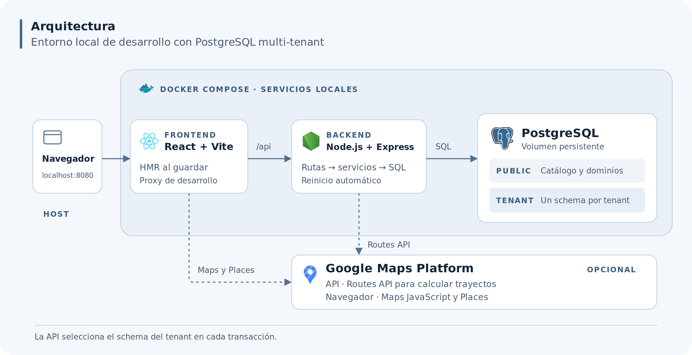

---

## Índice

1. [Qué resuelve](#1-qué-resuelve)
2. [Inicio rápido](#2-inicio-rápido)
3. [Estructura de carpetas](#3-estructura-de-carpetas)
4. [Arquitectura general](#4-arquitectura-general)
5. [Arquitectura del backend](#5-arquitectura-del-backend)
6. [Multi-tenant: un schema por institución](#6-multi-tenant-un-schema-por-institución)
7. [Modelo de datos (entidad-relación)](#7-modelo-de-datos-entidad-relación)
8. [Reglas de negocio importantes](#8-reglas-de-negocio-importantes)
9. [Diagramas de procesos](#9-diagramas-de-procesos)
10. [Arquitectura del frontend](#10-arquitectura-del-frontend)
11. [API](#11-api)
12. [Tecnologías y por qué las elegimos](#12-tecnologías-y-por-qué-las-elegimos)
13. [Variables de entorno](#13-variables-de-entorno)
14. [Pruebas y calidad](#14-pruebas-y-calidad)
15. [Comandos útiles](#15-comandos-útiles)
16. [Limitaciones conocidas y siguientes pasos](#16-limitaciones-conocidas-y-siguientes-pasos)
17. [Diagramas y documentación relacionada](#17-diagramas-y-documentación-relacionada)

---

## 1. Qué resuelve

En hora pico, muchos autos circulan con una sola persona por las mismas avenidas, mientras otras personas esperan un transporte público saturado. Hay asientos vacíos, pero no hay una forma simple de que conductor y pasajero coincidan en ruta y horario.

| Idea | Cómo se ve en la app |
|---|---|
| **Comunidad cerrada** | Solo entra quien tiene un correo de un dominio permitido de su institución (`@ucaribe.edu.mx`). Cada institución tiene sus datos aislados en su propio schema |
| **Rutas flexibles** | El conductor marca su trayecto real y el pasajero camina hasta un punto **sobre esa ruta** (a 400 m o menos). El conductor no se desvía |
| **Publicar en un toque** | Como el trayecto se repite, el conductor lo guarda como plantilla y publica con **"Salgo hoy"** |
| **Sin sobreventa** | Nunca hay más reservas confirmadas que asientos. Lo cuidan Express y la base de datos (trigger) |
| **Impacto medible** | Contador de viajes, asientos y km compartidos y CO₂ evitado, con fórmula, factor y fuente visibles (RF-23 y RF-24). En **Tu impacto** se ve como huella de carbono (por ahora con datos de ejemplo) |

Los requisitos completos (RF y RNF) están en [`Frontend/AGENTS.MD`](Frontend/AGENTS.MD) y la guía visual en [`Frontend/DESIGN.MD`](Frontend/DESIGN.MD).

---

## 2. Inicio rápido

### Con Docker (recomendado)

Desde la raíz, con Docker y el plugin Compose:

```bash
docker compose up
```

Abre **http://localhost:5173**. Compose hace esto:

1. Levanta **PostgreSQL 16** y espera a que acepte conexiones.
2. Levanta la **API**, que al arrancar aplica las migraciones (`public` y cada tenant) y carga los datos de demostración.
3. Levanta **Vite**, que es el único servicio con puerto publicado en el host (`127.0.0.1:${APP_PORT:-5173}`) y reenvía `/api/*` a la API.

- Vite recarga el frontend al guardar (HMR) y Node reinicia la API al editar sus módulos (`node --watch`).
- `docker compose down` detiene todo y conserva el volumen `yendo_postgres_data`.
- Si cambias dependencias o un Dockerfile: `docker compose up --build`.

El `.env` de la raíz es opcional (está en `.gitignore`):

| Variable | Para qué |
|---|---|
| `APP_PORT` | Puerto del frontend en el host (por defecto `5173`) |
| `GOOGLE_MAPS_API_KEY` | Llave de servidor para **Routes API** |
| `VITE_GOOGLE_MAPS_API_KEY` | Llave de navegador para **Maps JavaScript + Places** |

Sin llaves la app funciona igual: las rutas se simulan y el mapa se dibuja como un esquema SVG.

### Sin Docker (cada proyecto por separado)

```bash
# Terminal 1: base de datos y API
cd Backend
cp .env.example .env          # y ajusta los valores
docker compose up -d          # solo PostgreSQL (proyecto "backend", volumen backend_postgres_data)
npm install && npm run dev    # http://localhost:3000 · Swagger en http://localhost:3000/docs

# Terminal 2: frontend
cd Frontend
npm install && npm run dev    # http://localhost:5173 (proxy /api → localhost:3000)
```

### Cuentas demo

Contraseña de todas: **`secreta123`**. En la pantalla de acceso hay botones para entrar con ellas.

| Cuenta | Para qué sirve |
|---|---|
| `valeria.pasajera@ucaribe.edu.mx` | Pasajera sin reservas: úsala para recorrer la demo completa |
| `carla.conductora@ucaribe.edu.mx` | Conductora con un viaje mañana a las 07:12 e historial para el impacto |
| `ana.conductora@ucaribe.edu.mx` | Conductora con viajes en todos los estados, reservas y chat |

**Demo en dos dispositivos:** Valeria busca desde *Plaza Cancún 2000 (Av. Kabah)* para mañana a las 07:00, pide el viaje de Carla, Carla lo acepta en *Mis viajes → detalle* y las dos chatean dentro del viaje.

Para tener muchos datos (56 conductores, 3 días de viajes): `cd Backend && npm run demo:datos -- --limpiar` con la API corriendo.

---

## 3. Estructura de carpetas

```
.
├── compose.yml                 # Docker Compose: postgres + backend + frontend (un comando)
├── README.md                   # este documento
├── CLAUDE.md                   # notas rápidas del monorepo para agentes
├── diagramas/                  # PNG listos para presentar
│   ├── arquitectura.png
│   └── entidad-relacion.png
├── docs/                       # fuentes de los diagramas
│   ├── arquitectura.svg
│   ├── entidad-relacion.svg
│   ├── entidad-relacion.py     # genera el SVG del modelo E-R
│   └── procesos/*.mmd          # diagramas de procesos (Mermaid)
│
├── Backend/                    # API: Node.js 24 + Express 5 + PostgreSQL 16
│   ├── CLAUDE.md               # reglas detalladas del backend (léelo antes de cambiar algo)
│   ├── Dockerfile
│   ├── docker-compose.yml      # solo PostgreSQL, para desarrollo sin el compose de la raíz
│   ├── .env.example
│   ├── public/prueba.html      # página para probar registro/login a mano (solo fuera de producción)
│   ├── scripts/datos-demo.js   # genera datos masivos llamando al API real
│   ├── tests/                  # tests de integración (node:test + supertest, Postgres real)
│   └── src/
│       ├── server.js           # arranque: BD → migraciones/seeds → listen → job de cierre
│       ├── app.js              # Express: middlewares globales y montaje de rutas
│       ├── config/
│       │   ├── env.js          # único lugar que lee process.env
│       │   └── db.js           # Pool de pg, withTransaction, withTenant, quoteSchema
│       ├── db/
│       │   ├── migrate.js      # runner propio de migraciones y seeds
│       │   ├── public/         # migraciones del schema public (instituciones, dominios, enums)
│       │   ├── tenant/         # migraciones que se aplican a CADA schema de institución
│       │   └── seeds/          # datos demo idempotentes (public y tenant/<schema>/)
│       ├── docs/openapi.js     # contrato OpenAPI (Swagger en /docs)
│       ├── jobs/cierreAutomatico.js  # RF-20: cierra viajes vencidos de todas las instituciones
│       ├── modules/            # una carpeta por funcionalidad (ver sección 5)
│       │   └── <modulo>/<modulo>.{routes,controller,service,repository}.js
│       └── shared/
│           ├── constants/      # roles, estados, tipos de notificación
│           ├── errors/         # AppError y subclases (400, 401, 403, 404, 409, 502)
│           ├── maps/           # rutas: Google Routes API o proveedor simulado
│           ├── middlewares/    # auth (requireAuth/requireRole), adminKey, cors, errorHandler
│           └── utils/          # jwt, geo, emparejamiento (reglas de matching), validacion, formato
│
└── Frontend/                   # React 19 + Vite 8 + Tailwind 4
    ├── AGENTS.MD               # requisitos del producto (RF/RNF, reglas de matching, fórmula de impacto)
    ├── DESIGN.MD               # identidad visual y tokens
    ├── README.md               # cómo correrlo y la tabla pantallas ↔ requisitos
    ├── Dockerfile
    ├── vite.config.js          # proxy /api → backend
    ├── public/                 # logo, favicon, íconos
    └── src/
        ├── main.jsx · App.jsx  # montaje, sesión y elección de pantalla
        ├── index.css           # Tailwind + tokens de diseño (@theme)
        ├── styles/             # base, ui, layout, trip, chat, pages y desktop (≥ 1024 px)
        ├── constants/pages.js  # catálogo de pantallas
        ├── context/AuthContext.jsx
        ├── hooks/              # useAppNavigation, useAsync (con polling), useChat, useUbicacion
        ├── lib/                # api (fetch + token), format, geo, googleMaps, horas
        ├── components/         # auth, chat, forms, layout, map, modals, trip, ui
        └── pages/              # Home, Publish, History, TripDetail, DriverDetail, Impact, Login
```

---

## 4. Arquitectura general

Son tres piezas, las tres orquestadas con Docker Compose en desarrollo:

| Pieza | Responsabilidad |
|---|---|
| **Frontend** (React + Vite) | Interfaz móvil primero. Habla solo con el API, por `/api/*`. Dibuja mapas con Maps JavaScript y autocompleta direcciones con Places |
| **Backend** (Node.js + Express) | Reglas de negocio, autenticación, matching de rutas y cálculo de impacto. Llama a **Routes API** una sola vez por ruta |
| **PostgreSQL** | Un schema `public` global y **un schema por institución** con las tablas de negocio |

Así viaja una petición autenticada:

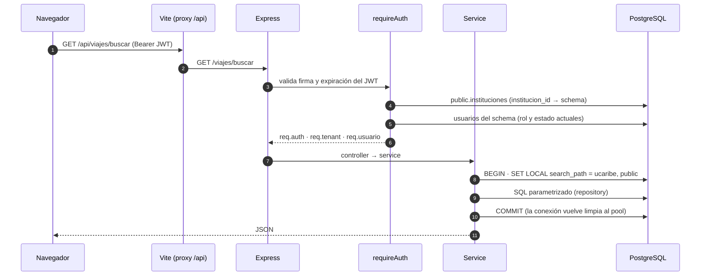

- **Google Maps usa dos llaves distintas.** La del navegador (`VITE_GOOGLE_MAPS_API_KEY`) es pública, está restringida por dominio y solo sirve para dibujar y autocompletar. La del servidor (`GOOGLE_MAPS_API_KEY`) está restringida por IP y solo tiene Routes API. **La ruta se calcula una sola vez, en el backend**, al publicar un viaje o guardar una plantilla. Republicar y "Salgo hoy" reutilizan la polilínea guardada.
- **En producción** el frontend usa `VITE_API_URL` y el backend tiene que listar ese origen en `CORS_ORIGINS`. En desarrollo no hace falta CORS por el proxy de Vite.

---

## 5. Arquitectura del backend

### Modular por funcionalidad, en capas

Cada funcionalidad vive en `src/modules/<modulo>/` con cuatro archivos y una dependencia en un solo sentido:

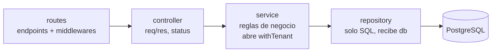

| Capa | Hace | No hace |
|---|---|---|
| `routes` | Declara endpoints y monta `requireAuth`/`requireRole` | Lógica |
| `controller` | Lee `req`, llama al service y responde con el status | Reglas de negocio ni errores "a mano" |
| `service` | Valida reglas, abre la transacción del tenant (`withTenant`) y lanza errores tipados | Tocar `req`/`res` |
| `repository` | SQL parametrizado (`$1, $2`), sin prefijo de schema en las tablas del tenant | Importar el `pool` (usa el `db` que recibe) |

**Por qué no hexagonal:** se evaluó y se descartó por costosa para un hackatón. Con la arquitectura modular cada funcionalidad queda en su propia carpeta y las capas son fáciles de probar sin tanta ceremonia.

### Módulos y dependencias

| Módulo | Qué cubre |
|---|---|
| `auth` | Registro, login y `/auth/me`. JWT, bcrypt y resolución del tenant por dominio |
| `instituciones` | Alta de institución (crea su schema y lo migra), protegida con `X-Admin-Key` |
| `vehiculos` | Alta, lista y baja lógica de vehículos |
| `viajes` | Publicar, republicar, cancelar, buscar, "mis viajes" y cierre de vencidos |
| `trayectos` | Plantillas de ruta y "Salgo hoy" |
| `reservas` | Solicitar, aceptar, rechazar y cancelar, con control de cupo y traslapes |
| `mensajes` | Chat del viaje (polling) |
| `ubicaciones` | Ubicación en vivo del conductor, sin historial |
| `notificaciones` | Avisos dentro de la app |
| `impacto` | Contador de CO₂ evitado y su metodología |

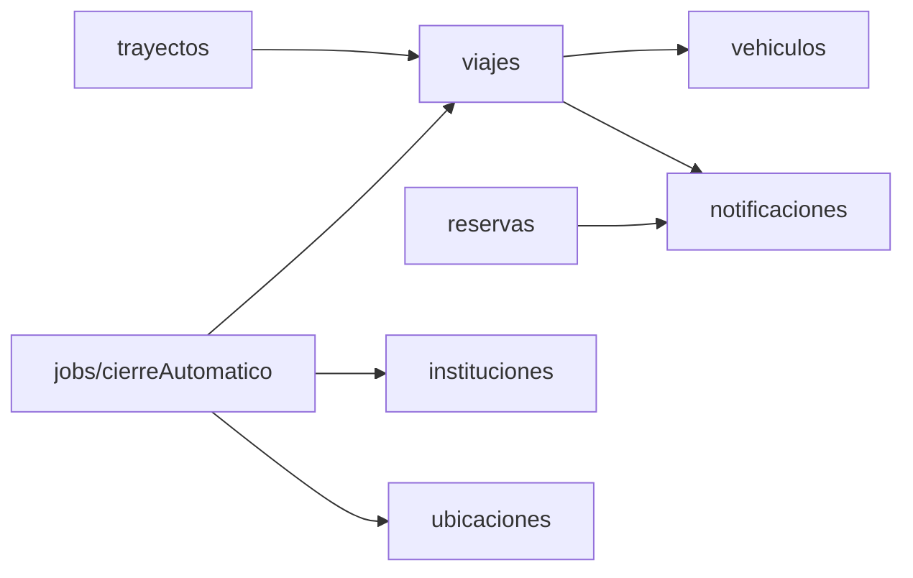

- Un módulo **no** importa el repository de otro: usa su service. No debe haber ciclos.
- Si dos módulos necesitan la **misma transacción**, el service expone una función que recibe `db` (`viajes.guardarEnTransaccion(db, …)`, `notificaciones.crearEnTransaccion(db, …)`).
- **Errores:** todos extienden `AppError` (`ValidationError` 400, `UnauthorizedError` 401, `ForbiddenError` 403, `NotFoundError` 404, `ConflictError` 409, `BadGatewayError` 502). `errorHandler` responde siempre con el mismo formato `{ "error": { "codigo", "mensaje", "detalles?" } }`, y el frontend se guía por `codigo` (`VIAJE_LLENO`, `RESERVA_TRASLAPADA`…).
- **Job de cierre (RF-20):** corre dentro del mismo proceso cada `CIERRE_INTERVALO_SEG`. Recorre todas las instituciones activas, cierra los viajes vencidos (salida + 60 min), pasa las reservas confirmadas a `completada` (eso suma al impacto), expira las solicitudes y borra las ubicaciones en vivo.

Las reglas completas (convenciones, errores por endpoint y tests) están en [`Backend/CLAUDE.md`](Backend/CLAUDE.md).

---

## 6. Multi-tenant: un schema por institución

El **tenant es la institución** (UCaribe, por ejemplo). PostgreSQL tiene:

- **`public`** (global): `instituciones`, `dominios_permitidos`, los enums y la extensión `citext`.
- **Un schema por institución** (`ucaribe`, …) con las mismas tablas de negocio: `usuarios`, `vehiculos`, `trayectos`, `viajes`, `reservas`, `mensajes`, `notificaciones` y `ubicaciones_viaje`.

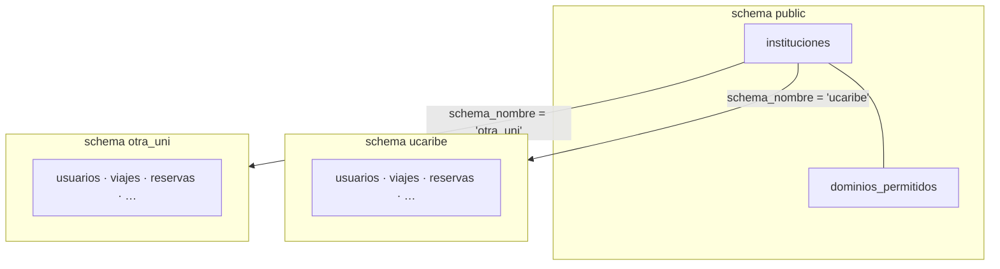

### Por qué un schema por tenant

| Opción | Por qué sí o por qué no |
|---|---|
| Columna `institucion_id` en cada tabla | Un solo `WHERE` olvidado filtra datos de otra universidad. Hay que repetir el filtro en cada consulta e índice |
| Una base de datos por tenant | Aislamiento total, pero más conexiones, más costo y migraciones más complicadas para un MVP |
| **Un schema por tenant** ✅ | Aislamiento fuerte con una sola base y un solo pool. El SQL del negocio no cambia (`SELECT * FROM viajes`) y cada institución se puede respaldar, exportar o borrar por separado |

### Cómo se resuelve el tenant

1. **Registro:** el dominio del correo debe coincidir exactamente con un `dominios_permitidos` activo de una institución activa. Eso decide el schema (los subdominios se registran como filas aparte).
2. **Login:** igual, por dominio. Los errores dan siempre el mismo 401 para no revelar qué correos existen.
3. **Peticiones autenticadas:** el JWT trae `institucion_id`. `requireAuth` busca el schema en `public.instituciones` y carga al usuario **desde la BD** en cada petición. Así, desactivar a alguien o cambiarle el rol aplica al instante.

### Aislamiento de conexiones (`withTenant`)

```js
// config/db.js
withTenant(schema, async (db) => {
  // BEGIN; SET LOCAL search_path TO "ucaribe", public;
  return repo.buscar(db, ...)   // SQL sin prefijo de schema
})                              // COMMIT/ROLLBACK y la conexión vuelve limpia
```

- **Nunca** se hace `SET search_path` sobre el pool: la conexión regresaría al pool con el schema de otro tenant. `SET LOCAL` solo dura la transacción.
- El nombre del schema **nunca** sale del input del usuario: se lee de `public.instituciones`, se valida con `^[a-z_][a-z0-9_]{0,62}$` (la misma regla que el `CHECK` de la tabla) y se escapa con `escapeIdentifier` (`quoteSchema`).

### Alta de una institución y migraciones

- `POST /instituciones` con el header `X-Admin-Key`. En **una sola transacción** inserta la institución y sus dominios, crea el schema y le aplica todas las migraciones de `src/db/tenant/`. Si algo falla, no queda nada a medias.
- El runner (`src/db/migrate.js`) aplica los `.sql` en orden, cada uno en su transacción, y los registra en `public.schema_migrations` o `<schema>.schema_migrations`. Las migraciones de tenant se corren sobre **todos** los schemas existentes. Una migración ya aplicada **no se edita**: se crea una nueva.

---

## 7. Modelo de datos (entidad-relación)

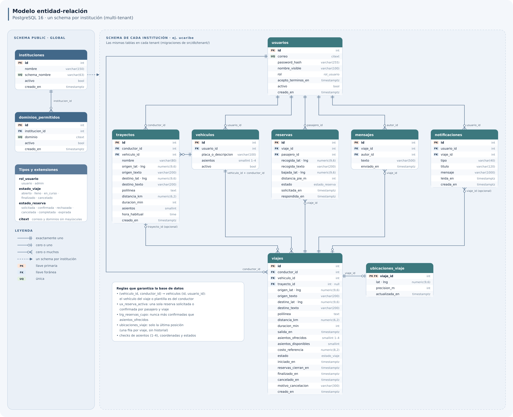

| Tabla | Qué guarda |
|---|---|
| `public.instituciones` | Cada tenant y el nombre de su schema |
| `public.dominios_permitidos` | Lista blanca de dominios de correo por institución (`citext`, únicos) |
| `usuarios` | Cuenta, contraseña (bcrypt), nombre visible, rol (`usuario`/`admin`) y estado |
| `vehiculos` | Vehículos del conductor (1–4 asientos). Se desactivan, no se borran |
| `trayectos` | Plantillas "Salgo hoy": origen, destino, vehículo, asientos y ruta ya calculada |
| `viajes` | Viaje publicado: ruta (polilínea), salida, asientos, costo de referencia y ciclo de vida |
| `reservas` | Solicitud de un asiento: punto de recogida/bajada, distancia a pie y estado |
| `mensajes` | Chat del viaje |
| `notificaciones` | Avisos dentro de la app (solicitud, confirmación, rechazo, cancelación) |
| `ubicaciones_viaje` | **Solo la última** posición del conductor, una fila por viaje |

**Ciclos de vida**

- Viaje: `abierto → lleno ⇄ abierto → en_curso → finalizado`, o `cancelado`.
- Reserva: `solicitada → confirmada → completada`, o `rechazada` / `cancelada` / `expirada`.

**Reglas que garantiza la propia base de datos**

- La FK compuesta `(vehiculo_id, conductor_id) → vehiculos (id, usuario_id)` asegura que el vehículo de un viaje o plantilla sea del conductor.
- `ux_reserva_activa` (índice único parcial): una sola reserva `solicitada`/`confirmada` por pasajero y viaje.
- El trigger `trg_reservas_cupo` impide más reservas confirmadas que `asientos_ofrecidos`, aunque haya dos confirmaciones simultáneas o SQL directo.
- `CHECK` de asientos (1–4), de coordenadas y de estados (`chk_iniciado`, `chk_finalizado`, `chk_cancelado`).

---

## 8. Reglas de negocio importantes

### Coincidencia de rutas (matching)

Viven en un solo lugar, `Backend/src/shared/utils/emparejamiento.js`, y las usan tanto la búsqueda como `POST /reservas`: lo que aparece en la búsqueda también se puede solicitar.

- La ruta del conductor pasa a **menos de R = 400 m** del punto de recogida (y de bajada, si se manda).
- La salida está dentro de **±15 min** de la hora deseada.
- La recogida queda **antes** que la bajada en el sentido del viaje.
- Hay asientos disponibles, el viaje acepta solicitudes y no es del propio usuario.
- La distancia se calcula **en JS** con la polilínea guardada (proyección al tramo más cercano), **sin llamar a Google**. Los resultados se ordenan por distancia a pie y luego por cercanía en hora.

### Asientos y concurrencia (RNF-05)

- Pedir un asiento no lo descuenta: se descuenta cuando el conductor **acepta**, en la misma transacción y con el viaje bloqueado (`SELECT … FOR UPDATE`).
- Si se llena, el viaje pasa a `lleno` y las demás solicitudes se rechazan solas, con aviso.
- **Orden de bloqueo** fijo (primero el viaje, luego la reserva) para evitar deadlocks. Los traslapes de horario del conductor y del pasajero se serializan con `FOR NO KEY UPDATE`.

### Privacidad (RNF-03, RNF-04)

- El origen y el destino del conductor se **redondean a ~100 m** antes de guardarse y de calcular la ruta: ni las coordenadas ni la polilínea revelan su domicilio.
- La ubicación en vivo es opcional, solo con la app abierta, la ven únicamente el conductor y sus pasajeros confirmados, y **no guarda historial**. El job la borra al cerrar el viaje.

### Impacto ambiental (RF-23, RF-24)

```
CO₂ evitado (kg) = km compartidos × 0.249 kg CO₂/km
```

- **Factor:** 400 g CO₂/milla (US EPA, auto promedio de pasajeros) ÷ 1.609 km/milla.
- **Qué cuenta:** solo reservas `completada`, es decir, viajes cerrados con el pasajero confirmado.
- La metodología (fórmula, factor, fuente, supuestos y la etiqueta "Estimación") vive en `impacto.service.js` y el frontend la muestra tal cual: no hay números "mágicos" en la interfaz.

---

## 9. Diagramas de procesos

Las fuentes están en [`docs/procesos/`](docs/procesos) (Mermaid). GitHub las dibuja aquí mismo; para pasarlas a PNG ver la [sección 17](#17-diagramas-y-documentación-relacionada).

### 9.1 Proceso general

De punta a punta: quién hace qué entre el conductor, el sistema y el pasajero.

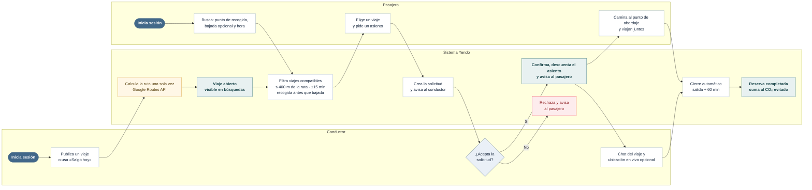

### 9.2 Registro e inicio de sesión

El dominio del correo decide la institución (tenant). El login responde siempre el mismo error para no revelar qué correos existen.

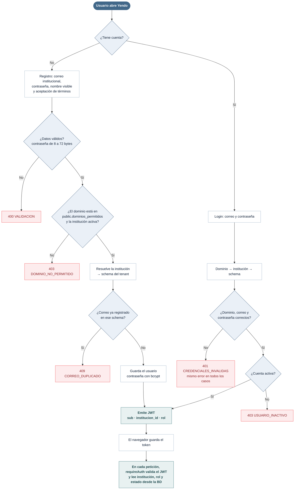

### 9.3 Publicar un viaje

Google se consulta solo para un viaje nuevo. "Salgo hoy" y "Publicar de nuevo" reutilizan la ruta guardada.

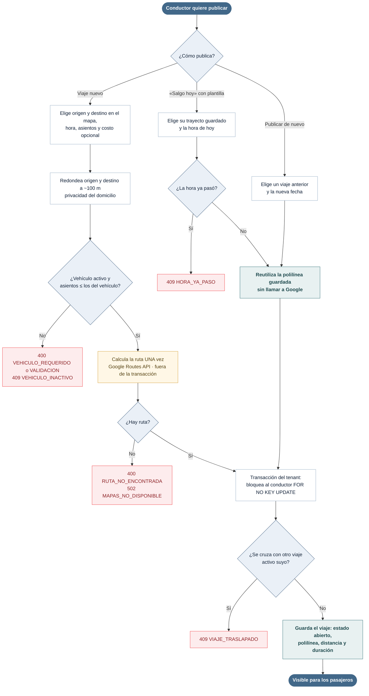

### 9.4 Buscar viaje y pedir asiento

Las mismas reglas filtran la búsqueda y validan la solicitud. Pedir un asiento todavía no lo descuenta.

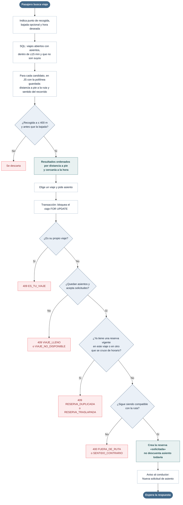

### 9.5 Responder una solicitud

El asiento se descuenta al aceptar, con el viaje bloqueado. El trigger de la base de datos es la última barrera contra la sobreventa.

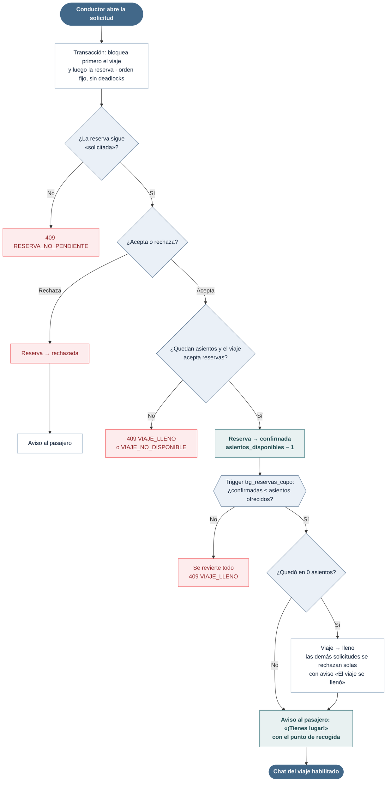

### 9.6 Cancelaciones

Todo pasa en una sola transacción y siempre se avisa a la otra parte.

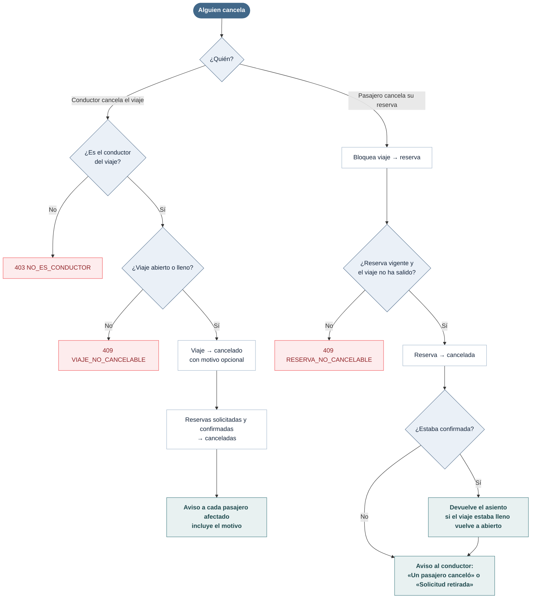

### 9.7 Cierre automático

Job dentro del proceso del API. Si una institución falla, sigue con las demás.

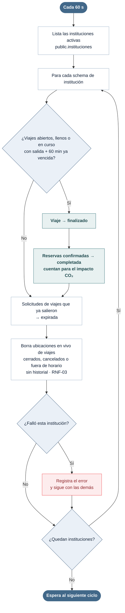

### 9.8 Estados del viaje y de la reserva

El estado `en_curso` existe en la base de datos, pero todavía no hay un endpoint para iniciar el viaje.

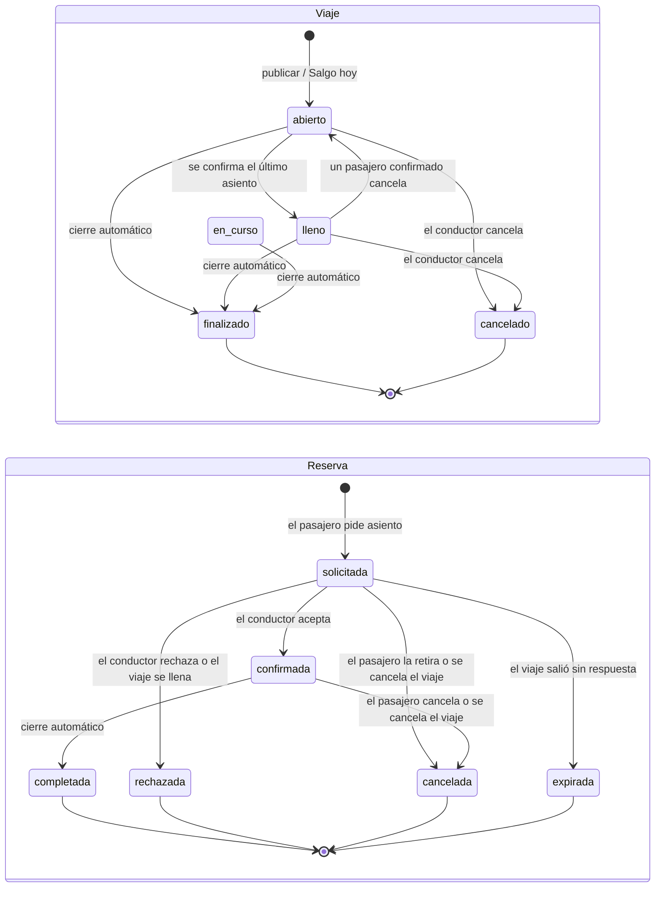

---

## 10. Arquitectura del frontend

- **Sin router:** es una app de una sola vista. `useAppNavigation` guarda `{ page, params }` y `App.jsx` elige la pantalla en `SCREENS`. `ScreenTransition` anima el cambio (180 ms, respeta "reducir movimiento").
- **Datos:** `lib/api.js` envuelve `fetch`, agrega el `Bearer` y traduce los errores del API. `useAsync` carga datos y hace **polling** solo con la pestaña visible (chat cada 4 s, ubicación en vivo cada 5 s, Inicio y avisos cada 20–30 s, impacto cada 60 s). Ya **no hay datos mock**: todo sale del API, salvo los números de la huella de carbono en *Tu impacto*.
- **Sesión:** `AuthContext` guarda el token en `localStorage` (con `try/catch`: si está bloqueado, la app sigue funcionando sin recordar la sesión).
- **Mapas:** con llave se usa Google Maps y se dibuja la polilínea que mandó el backend. Sin llave, un **esquema SVG**. Places autocompleta con debounce de 300 ms y sesiones (menos costo).
- **Diseño responsivo:**
  - **Celular** (< 1024 px): pantalla con forma de teléfono y navegación inferior *Inicio · Publicar · Mis viajes*. *Tu impacto* se abre desde el ícono de usuario.
  - **Escritorio** (≥ 1024 px, `styles/desktop.css`): barra lateral fija y contenido **alineado a la izquierda** junto a ella (máx. 1120 px). Las listas van a dos columnas y los detalles muestran la información a la izquierda y el mapa fijo a la derecha.
- **Tokens de diseño** (`src/index.css`, `@theme`):

  | Token | Uso |
  |---|---|
  | `coral` `#F15156` | Acción principal y lo que está en marcha o pendiente |
  | `teal` `#3C787E` | Confirmado o listo, e impacto ambiental |
  | `surface`, `ink`, `muted`, `line` | Fondos, texto y bordes |

| Pantalla | Archivo | Requisitos |
|---|---|---|
| Acceso y registro | `pages/LoginPage.jsx` | RF-01, RF-02 |
| Inicio (buscar y solicitar) | `pages/HomePage.jsx` + modales | RF-12 a RF-15, RF-19, RF-22 |
| Publicar / "Salgo hoy" | `pages/PublishPage.jsx` | RF-03 (vehículo), RF-05 a RF-07, RF-09 |
| Mis viajes | `pages/HistoryPage.jsx` | RF-08, RF-10 |
| Detalle como conductor | `pages/DriverDetailPage.jsx` | RF-11, RF-16 a RF-18, RF-21, chat y ubicación en vivo |
| Detalle como pasajero | `pages/TripDetailPage.jsx` | RF-15, RF-18, chat y conductor en vivo |
| Tu impacto (desde el perfil) | `pages/ImpactPage.jsx` | Huella de carbono (**mockup**) + metodología real de RF-24 |

La tabla completa está en [`Frontend/README.md`](Frontend/README.md).

---

## 11. API

El contrato completo está en **Swagger**: `http://localhost:3000/docs` (JSON en `/docs.json`), corriendo el backend sin Docker. Resumen:

| Área | Endpoints |
|---|---|
| Auth | `POST /auth/register`, `POST /auth/login`, `GET /auth/me` |
| Plataforma | `POST /instituciones` (header `X-Admin-Key`) |
| Vehículos | `POST /vehiculos`, `GET /vehiculos`, `DELETE /vehiculos/:id` |
| Viajes | `POST /viajes`, `GET /viajes/buscar`, `GET /viajes/proximos`, `GET /viajes/mios`, `GET /viajes/:id`, `POST /viajes/:id/republicar`, `POST /viajes/:id/cancelar` |
| Plantillas | `POST /trayectos`, `GET /trayectos`, `DELETE /trayectos/:id`, `GET/POST /trayectos/:id/salgo-hoy` |
| Reservas | `POST /reservas`, `GET /reservas/mias`, `GET /reservas/:id`, `POST /reservas/:id/{aceptar,rechazar,cancelar}` |
| Chat | `GET/POST /viajes/:viajeId/mensajes` |
| Ubicación en vivo | `PUT/GET/DELETE /viajes/:viajeId/ubicacion` |
| Avisos | `GET /notificaciones`, `POST /notificaciones/:id/leida` |
| Impacto | `GET /impacto` → `{ institucion, mio, metodologia }` |

---

## 12. Tecnologías y por qué las elegimos

### Backend

| Tecnología | Por qué |
|---|---|
| **Node.js 24** | El mismo lenguaje (JavaScript) en frontend y backend: el equipo cambia de lado sin fricción. Trae `--watch`, `--env-file` y `node:test` sin dependencias extra |
| **Express 5** | Mínimo y conocido. La versión 5 propaga sola los errores de los handlers `async`, sin `try/catch` ni `next(err)` |
| **PostgreSQL 16** | Necesitábamos **schemas** (multi-tenant), transacciones con `FOR UPDATE`, **triggers**, índices únicos parciales, `CHECK` y `citext` (correos sin distinguir mayúsculas). Así la integridad la garantiza la base y no solo el código |
| **`pg` sin ORM** | Control total del SQL y del `search_path` por transacción. Un ORM complica el schema por tenant y esconde los bloqueos (`FOR UPDATE`) que evitan la sobreventa. Todo el SQL va parametrizado |
| **JWT (`jsonwebtoken`)** | Sesión sin estado en el servidor, fácil de escalar. El token solo identifica: el rol y el estado se leen de la BD en cada petición |
| **`bcryptjs`** | Hash de contraseñas en JS puro, sin compilar binarios nativos en Docker |
| **`swagger-ui-express` + OpenAPI** | Contrato vivo del API para el equipo de frontend y para los jueces |
| **`node:test` + `supertest`** | Tests de integración contra Postgres real sin instalar un framework más |
| **Google Routes API** | Ruta de manejo real, consultada **una sola vez** por ruta y con un field mask mínimo para bajar el costo (RNF-09). Hay un proveedor **simulado** para trabajar sin red ni llave |

### Frontend

| Tecnología | Por qué |
|---|---|
| **React 19** | Componentes reutilizables entre pantallas; es lo que el equipo ya domina |
| **Vite 8** | Arranque instantáneo, HMR y un **proxy** a la API que evita CORS en desarrollo |
| **Tailwind CSS 4** | Los tokens de `DESIGN.MD` se declaran una vez en `@theme` y se usan como clases (`bg-coral`, `text-muted`). El CSS propio queda solo para piezas complejas |
| **motion** | Transiciones cortas entre pantallas y modales, con soporte de "reducir movimiento" |
| **lucide-react** | Íconos de línea delgada, como pide la guía visual |
| **Google Maps JavaScript + Places** | Mapa y autocompletado de direcciones en Cancún. Sin llave hay un esquema SVG de respaldo |

### Infraestructura

| Tecnología | Por qué |
|---|---|
| **Docker Compose** | Un solo `docker compose up` levanta base, API y frontend con migraciones y datos demo, igual en cualquier máquina |
| **Polling en vez de WebSockets** | Chat, avisos y ubicación funcionan bien para el MVP sin servidor de tiempo real ni estado compartido. Se puede migrar después sin cambiar el modelo |

---

## 13. Variables de entorno

**Backend** (`Backend/.env`, ver `.env.example`). Solo las lee `src/config/env.js`.

| Variable | Para qué |
|---|---|
| `POSTGRES_HOST/PORT/USER/PASSWORD/DB` | Conexión a PostgreSQL |
| `PORT` | Puerto del API (3000) |
| `JWT_SECRET`, `JWT_EXPIRES_IN` | Firma y duración del token |
| `PLATFORM_ADMIN_KEY` | Clave del header `X-Admin-Key` para dar de alta instituciones |
| `GOOGLE_MAPS_API_KEY`, `MAPS_PROVIDER` | Routes API (`google`) o rutas simuladas (`simulado`) |
| `APP_TIMEZONE` | Zona horaria para "Salgo hoy" y los avisos (`America/Cancun`) |
| `CIERRE_INTERVALO_SEG` | Cada cuánto corre el cierre automático (0 lo apaga) |
| `CORS_ORIGINS` | Orígenes permitidos del frontend en producción |

**Frontend** (`Frontend/.env.local`):

| Variable | Para qué |
|---|---|
| `VITE_API_URL` | URL del API en producción (vacía en desarrollo) |
| `VITE_GOOGLE_MAPS_API_KEY` | Maps JavaScript + Places |

---

## 14. Pruebas y calidad

```bash
cd Backend && npm test                              # integración contra Postgres real
cd Frontend && npx eslint . && npx vite build       # lint y build
```

- `npm test` usa la base `hackaton_test`, que **se borra y se recrea** en cada corrida (aborta si el nombre no termina en `_test`).
- Los tests verifican el status, el `error.codigo` **y** el efecto real en la BD (fila en el schema correcto, nada creado en los casos de error).
- Cubren: autenticación y aislamiento por tenant, alta de instituciones, publicación, matching, reservas con concurrencia, chat, ubicación, impacto, cierre automático y que los datos demo produzcan la búsqueda esperada.
- Con `mock.method(mapas, 'calcularRuta')` se cuenta cuántas veces se llama a Google (RF-07: una por ruta).

---

## 15. Comandos útiles

| Dónde | Comando | Qué hace |
|---|---|---|
| raíz | `docker compose up` / `down` | Levanta o detiene todo |
| raíz | `docker compose up --build` | Reconstruye las imágenes tras cambiar dependencias |
| `Backend/` | `npm run dev` | API en modo watch |
| `Backend/` | `npm run db:migrate` / `db:seed` / `db:setup` | Migraciones, seeds o ambos |
| `Backend/` | `npm run demo:datos -- --limpiar` | 56 conductores y 3 días de viajes con la API real |
| `Backend/` | `npm test` | Tests de integración |
| `Frontend/` | `npm run dev` / `npm run build` / `npm run lint` | Desarrollo, build y lint |

---

## 16. Limitaciones conocidas y siguientes pasos

- **Huella de carbono:** los números de *Tu impacto* (`ImpactPage.jsx`) son un **mockup** con datos de ejemplo; la metodología sí viene del API. Siguiente paso: un endpoint (`GET /impacto/huella`) que use el mismo factor de `impacto.service.js` y sume también los km recorridos sin compartir.
- **Factor de emisión:** es el promedio de EE. UU. (EPA). Lo ideal sería un factor de México o por tipo de vehículo.
- **Sin verificación de correo ni recuperación de contraseña:** la comunidad cerrada depende solo del dominio.
- **Tiempo real por polling:** suficiente para el MVP; con muchos usuarios convendría pasar a WebSockets o SSE.
- **Distancia a pie en línea recta**, no por calles. R = 400 m es un valor inicial que hay que ajustar probando rutas reales de Cancún.
- **Viajes no verificados:** una reserva `completada` significa que el viaje se cerró con el pasajero confirmado, no que el viaje ocurrió.

---

## 17. Diagramas y documentación relacionada

| Archivo | Contenido |
|---|---|
| [`diagramas/arquitectura.png`](diagramas/arquitectura.png) · [`docs/arquitectura.svg`](docs/arquitectura.svg) | Arquitectura de servicios (Compose, API, PostgreSQL y Google Maps) |
| [`diagramas/entidad-relacion.png`](diagramas/entidad-relacion.png) · [`docs/entidad-relacion.svg`](docs/entidad-relacion.svg) | Modelo entidad-relación (public + schema por institución) |
| [`docs/procesos/`](docs/procesos) | Diagramas de procesos en Mermaid: general, acceso, publicar, buscar y solicitar, responder, cancelar, cierre y estados |
| [`Backend/CLAUDE.md`](Backend/CLAUDE.md) | Reglas detalladas del backend: endpoints por RF, errores, tests |
| [`Frontend/README.md`](Frontend/README.md) | Cómo correr el frontend y pantallas ↔ requisitos |
| [`Frontend/AGENTS.MD`](Frontend/AGENTS.MD) | Requisitos del producto |
| [`Frontend/DESIGN.MD`](Frontend/DESIGN.MD) | Guía visual y tokens |

**Diagramas de procesos a PNG:** pega el contenido de un `.mmd` en [mermaid.live](https://mermaid.live) y descárgalo como PNG, o usa `npx @mermaid-js/mermaid-cli -i docs/procesos/02-publicar-viaje.mmd -o diagramas/procesos/02-publicar-viaje.png -s 2`.

**Regenerar el diagrama E-R** (si cambian las migraciones, actualiza las tablas en el script):

```bash
python3 docs/entidad-relacion.py docs/entidad-relacion.svg
# PNG: abre el SVG en el navegador y captura, o con Chromium headless:
chromium --headless --screenshot=diagramas/entidad-relacion.png --window-size=2060,1674 \
  --force-device-scale-factor=2 docs/entidad-relacion.svg
```
